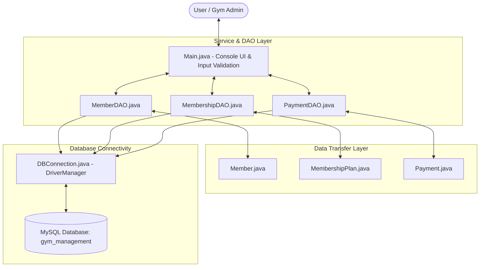
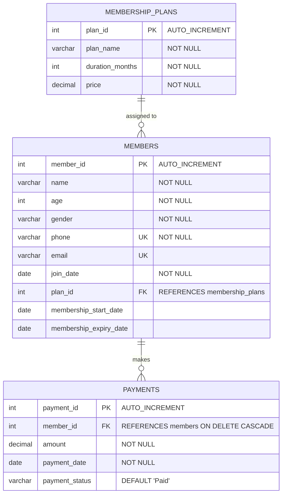

# 🏋️ Gym Membership Management System

A robust, modular, and beginner-friendly **Console-based Gym Membership Management System** built with **Core Java (Java 17)**, **JDBC**, and **MySQL**.

Designed specifically for undergraduate students and aspiring software engineers preparing for **Java Developer Fresher Interviews**, this project emphasizes clean coding standards, object-oriented design principles, the DAO (Data Access Object) architectural pattern, and secure database interactions.

---

## 📌 Table of Contents
1. [Key Features](#-key-features)
2. [Technology Stack](#-technology-stack)
3. [Architecture & Workflow](#-architecture--workflow)
4. [Database Design](#-database-design)
5. [Project Directory Structure](#-project-directory-structure)
6. [Core Java Concepts Implemented](#-core-java-concepts-implemented)
7. [Step-by-Step Setup Guide](#-step-by-step-setup-guide)
8. [How to Run](#-how-to-run)
9. [Git & GitHub Upload Guide](#-git--github-upload-guide)
10. [Top Interview Questions & Answers](#-top-interview-questions--answers)

---

## 🌟 Key Features

### 1. Member Management (CRUD)
- **Add Member**: Register new gym members with personal information (Name, Age, Gender, Phone, Email) and join date.
- **View All Members**: Tabular view of all registered members with their active membership plan and expiration status.
- **Search Member**: Instant lookup by Member ID with a profile view.
- **Update Member**: Edit contact details or personal details with pre-populated values.
- **Delete Member**: Safe deletion with cascade cleanup of linked payments.

### 2. Membership Plan Management
- **Add Plan**: Define flexible plans (Monthly, Quarterly, Half-Yearly, Yearly) with duration and pricing.
- **View Plans**: Inspect available gym packages with pricing and validity periods.
- **Assign Plan**: Connect a member to a membership plan; automatically computes and records the start date and expiry date based on the plan duration.

### 3. Payment Processing
- **Record Payments**: Track transactions linked to a member with amount, date, and payment status (`Paid`, `Pending`, `Failed`).
- **Payment History**: View complete transaction logs or filter history by specific Member ID.

---

## 🛠 Technology Stack

| Component | Technology / Tool | Purpose |
| :--- | :--- | :--- |
| **Language** | Java 17 (LTS) | Object-Oriented programming, Collections, Exception Handling |
| **Database** | MySQL Server 8.0+ | Relational data persistence, foreign keys, constraints |
| **Database Driver** | MySQL Connector/J (`mysql-connector-j-9.4.0.jar`) | JDBC Type-4 pure Java driver |
| **Design Pattern** | DAO (Data Access Object) Pattern | Decoupling persistence logic from business flow |
| **IDE / Editors** | VS Code / IntelliJ IDEA / Eclipse | Development and debugging |
| **Version Control** | Git & GitHub | Source code tracking and portfolio showcase |

---

## 🏗 Architecture & Workflow

The system is designed following the **Separation of Concerns (SoC)** principle:



### Flow of Data:
1. **User Interaction**: `Main.java` handles menu display, input parsing, and validation.
2. **Business Transfer**: Input data is encapsulated into Model POJOs (`Member`, `MembershipPlan`, `Payment`).
3. **Persistence (DAO)**: DAO classes execute SQL queries via `PreparedStatement` to prevent SQL Injection.
4. **Connection Management**: `DBConnection.java` manages database connections using try-with-resources to guarantee safe resource closure.

---

## 🗄 Database Design

Database name: `gym_management`



---

## 📁 Project Directory Structure

```text
gymmembership/
├── lib/
│   └── mysql-connector-j-9.4.0.jar      # JDBC Driver
├── sql/
│   └── schema.sql                        # Database creation and sample data script
├── src/
│   └── com/
│       └── gym/
│           ├── model/
│           │   ├── Member.java           # Member Entity POJO
│           │   ├── MembershipPlan.java   # Plan Entity POJO
│           │   └── Payment.java          # Payment Entity POJO
│           ├── dao/
│           │   ├── MemberDAO.java        # Member CRUD SQL operations
│           │   ├── MembershipDAO.java    # Plan SQL operations
│           │   └── PaymentDAO.java       # Payment SQL operations
│           ├── util/
│           │   └── DBConnection.java     # Singleton-like JDBC connection helper
│           └── main/
│               ├── Main.java             # Interactive CLI application
│               └── TestRunner.java       # Automated unit test suite
├── .gitignore
├── run.bat                               # Windows 1-click execution script
└── README.md                             # Project documentation
```

---

## 💡 Core Java Concepts Implemented

1. **Object-Oriented Programming (OOP)**:
   - **Encapsulation**: Private fields in model classes accessed strictly through getters and setters.
   - **Abstraction**: DAO layer abstracts raw SQL queries away from the user presentation layer.
2. **JDBC Architecture**:
   - `DriverManager`: Manages the database driver and creates connections.
   - `Connection`: Manages active database sessions.
   - `PreparedStatement`: Pre-compiled SQL statements that guard against SQL injection.
   - `ResultSet`: Navigates through query results and maps columns into Java objects.
3. **Java Collections Framework**:
   - `ArrayList` and `List<T>` to store, manipulate, and return data sets from queries.
4. **Modern Date and Time API (`java.time`)**:
   - `LocalDate` and `DateTimeFormatter` for handling plan durations and expiration dates.
5. **Exception Handling**:
   - Standard `try-catch` blocks and **try-with-resources** (`AutoCloseable`) ensuring zero connection or cursor leaks.
6. **Input Sanitization**:
   - Safe input helpers in `Main.java` preventing crashes caused by `InputMismatchException` or empty values.

---

## 🚀 Step-by-Step Setup Guide

### Step 1: Clone or Open the Project
Clone the repository or open the project folder in your IDE:
```bash
cd gymmembership
```

### Step 2: Set Up MySQL Database
Open **MySQL Workbench** or MySQL Command-Line Client and run:
```sql
source /absolute/path/to/gymmembership/sql/schema.sql;
```
*(Or copy and paste the contents of `sql/schema.sql` into MySQL Workbench and click **Execute**).*

### Step 3: Configure Database Credentials
Open `src/com/gym/util/DBConnection.java` and confirm your MySQL root password:
```java
private static final String DB_PASSWORD = "your_mysql_password";
```
*(Alternatively, you can set an environment variable `GYM_DB_PASS` without altering code).*

---

## 💻 How to Run

### Option A: Using Windows Batch Script (Fastest)
Double-click `run.bat` or run in terminal:
```cmd
.\run.bat
```

### Option B: Using Command Line (Terminal / PowerShell)

1. **Compile all Java source files:**
   ```powershell
   javac -cp ".;lib/*" -d bin src/com/gym/model/*.java src/com/gym/util/*.java src/com/gym/dao/*.java src/com/gym/main/*.java
   ```

2. **Run Automated Test Suite (Optional):**
   ```powershell
   java -cp "bin;lib/*" com.gym.main.TestRunner
   ```

3. **Launch the Main Application:**
   ```powershell
   java -cp "bin;lib/*" com.gym.main.Main
   ```

### Option C: In VS Code / IntelliJ IDEA
- **IntelliJ IDEA**: 
  1. Open the `gymmembership` folder.
  2. Right-click the `lib/mysql-connector-j-9.4.0.jar` -> Select **Add as Library**.
  3. Open `src/com/gym/main/Main.java` and click the green **Run** triangle.
- **VS Code**:
  1. Open folder in VS Code with "Extension Pack for Java" installed.
  2. The jar under `lib/` will be auto-recognized in `Java Projects -> Referenced Libraries`.
  3. Press `F5` or click **Run** above `public static void main`.

---

## 📤 Git & GitHub Upload Guide

Follow these commands to push this project to your GitHub account:

```bash
# 1. Initialize Git in the project root
git init

# 2. Stage all files
git add .

# 3. Create initial commit
git commit -m "feat: Initial commit for Gym Membership Management System"

# 4. Rename main branch
git branch -M main

# 5. Link to your GitHub repository (replace with your repo URL)
git remote add origin https://github.com/<your-username>/gym-membership-management.git

# 6. Push to GitHub
git push -u origin main
```

---

## 🎯 Top Interview Questions & Answers

Be prepared to answer these common fresher interview questions regarding this project:

#### 1. Why did you use `PreparedStatement` instead of `Statement`?
> **Answer**: `PreparedStatement` is precompiled by the database engine, offering two major advantages:
> - **Security**: It parameterizes inputs using `?` placeholders, preventing SQL Injection attacks.
> - **Performance**: When executed repeatedly, the query execution plan is reused.

#### 2. What is the DAO Pattern and why did you use it?
> **Answer**: DAO (Data Access Object) isolates the business and presentation logic from the database persistence logic. If the database schema or database engine changes in the future, only the DAO classes need to be updated; `Main.java` remains unaffected.

#### 3. How do you prevent resource leaks in JDBC?
> **Answer**: We use Java 7's **try-with-resources** statement. Any resource that implements `java.lang.AutoCloseable` (such as `Connection`, `PreparedStatement`, and `ResultSet`) declared within the try parenthesis is automatically closed when execution finishes, even if an exception occurs.

#### 4. What is the role of `Class.forName("com.mysql.cj.jdbc.Driver")`?
> **Answer**: It dynamically loads and registers the MySQL JDBC driver class with the `DriverManager`. While JDBC 4.0+ supports automatic driver loading via SPI, explicit loading ensures backward compatibility and demonstrates understanding of the driver lifecycle.

#### 5. How are dates handled between Java 17 and MySQL?
> **Answer**: We utilize the modern Java 8+ `java.time.LocalDate` API for business dates and convert to `java.sql.Date` using `java.sql.Date.valueOf(localDate)` when inserting into MySQL `DATE` columns, avoiding timezone discrepancies common with legacy `java.util.Date`.

---

## 📜 License
This project is open-source and available under the [MIT License](LICENSE).

# gymcrud

